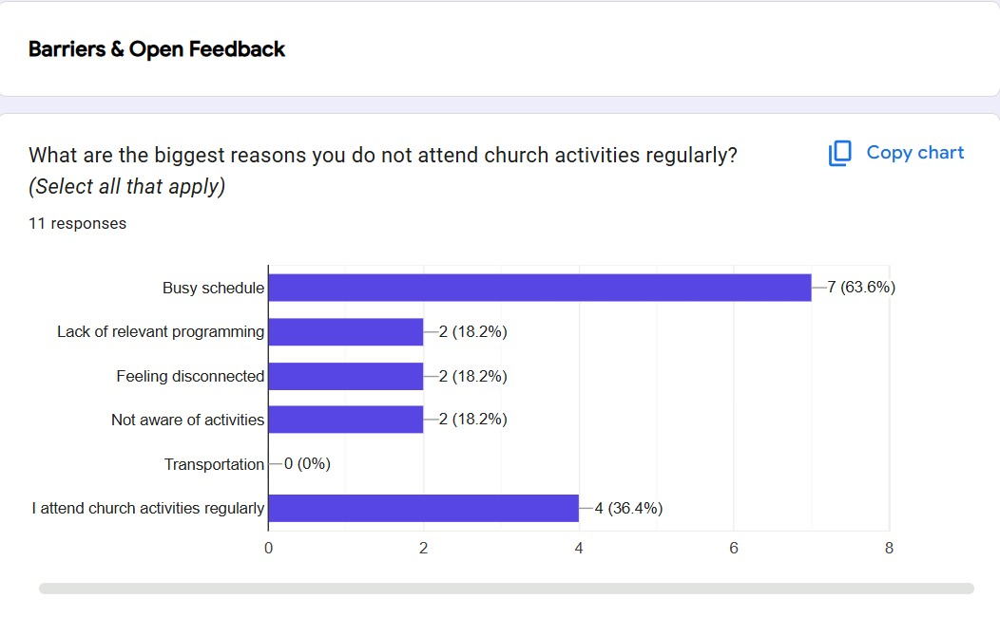

# 📊 Regional Demographic & Community Outreach Analytics

## 🚀 Project Overview
This project executed an end-to-end community outreach strategy to identify demographic trends, evaluate regional population shifts, and pinpoint engagement gaps within a 15-mile target radius. Managed using **CompTIA Project+** principles, the initiative combined macro-level census data, Power BI geospatial modeling, and qualitative survey workflows to guide strategic resource allocation for executive stakeholders.

---

## 📸 Sample Dashboards & Survey Visualizations

### 1. Macro-Demographic Power BI Dashboard
.jpg>).

### 2. Community Survey Findings & User Insights

---

## 🛠️ Technical Stack & Frameworks
* **Data Visualization & BI:** Power BI, DAX, Custom Demographic Pyramids, KPI Dashboards
* **Data Engineering & ETL:** Power Query, Data Cleaning, Relational Data Modeling
* **User Research & Survey Workflows:** Google Forms / Print Hybrid Survey Execution, Qualitative Analysis
* **Project Management:** CompTIA Project+ Framework, Work Breakdown Structure (WBS), Gantt Charts, Risk Mitigation

---

## 📈 Key Methodology & Project Phases

### 1. Macro-Demographic Analysis (Power BI & ETL)
* **Objective:** Differentiate broader regional population shifts from local organizational engagement challenges.
* **Data Sources:** U.S. Census Bureau (2010 vs. 2020) and longitudinal regional demographic datasets across Washington County and the surrounding regional valley.
* **Execution:** Preprocessed and cleaned multi-source datasets in Power Query; modeled relational schemas and built custom DAX metrics in Power BI to analyze 5-year age cohort pyramids, gender distribution, and spatial adherence density.

### 2. Community Survey & User Research Integration
* **Objective:** Capture direct qualitative feedback regarding participation friction points from the target youth/young adult demographic.
* **Execution:** Designed and deployed a hybrid digital and physical print survey workflow.
* **Key Findings:**
  * **63.6%** cited busy/conflicting schedules as the primary barrier to regular attendance.
  * **18.2%** identified a relevance gap in standard age-group programming.
  * **18.2%** reported feeling disconnected from existing congregational demographics.

### 3. Strategic Execution & Hybrid Program Design
* **In-Reach Strategy:** Designed a flexible, topical curriculum with peer-led mentorship groups to accommodate bi-weekly attendance patterns identified in the survey data.
* **Digital Outreach:** Upgraded and launched a centralized website hub ("Digital Front Door") to increase regional visibility, tracking visitor growth and web analytics to optimize digital outreach.

---

## 💼 Business Impact & Stakeholder Reporting
* **Executive Board Reporting:** Delivered data-driven visualization decks directly to the executive board to drive strategic resource allocations and program approvals.
* **Continuous Feedback Loop:** Built iterative survey data pipelines to capture ongoing feedback and adjust outreach scheduling dynamically.
